# TP1-DAR2026 : Les sockets en mode connecté TCP

## Membres du groupe

- Ben Maalem Yassine
- LSI3 3 G2

---

## Étape 1 & 2 : Environnement

### Version de Git

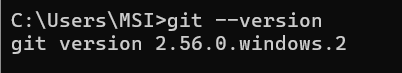

### Version de Java

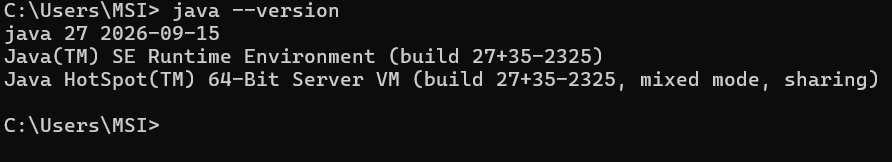

---

## Étape 3 : Le Serveur

- Code du serveur complété.
- Le serveur utilise le port `1234`.
- Le serveur attend la connexion d'un client avec la méthode `accept()`.

### Capture d'écran de la console du serveur

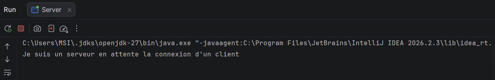

### Interprétation

La méthode `accept()` bloque l'exécution du serveur jusqu'à ce qu'un client se connecte. Une fois la connexion établie, le serveur affiche le message indiquant qu'un client est connecté.

---

## Étape 4 : Le Client

- Code du client complété.
- Le client se connecte au serveur avec une adresse IP.
- Adresse IP utilisée : `192.168.1.5`
- Port utilisé : `1234`

### Capture d'écran de la console du client

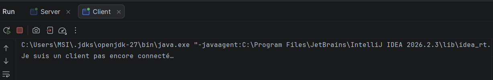

### Interprétation

Le client utilise la classe `Socket` pour établir une connexion TCP avec le serveur. Après la réussite de la connexion, le client affiche un message de confirmation, puis ferme la socket.

---

## Résultat

La connexion TCP entre le client et le serveur a été établie avec succès en utilisant l'adresse IP `192.168.1.4` et le port `1234`.

---

# Activité 1-2 : Service de calculatrice

## Objectif

L'objectif de cette activité est de développer le programme client-serveur précédent afin de permettre l'échange de données entre le client et le serveur.

Le client saisit un entier `x` et l'envoie au serveur. Le serveur reçoit cet entier, calcule le résultat de `x × 5`, puis renvoie le résultat au client.

---

## Étape 1 : Envoi d'un entier

Le client demande à l'utilisateur de saisir un entier à l'aide de la classe `Scanner`.

L'entier saisi est envoyé au serveur avec la méthode `writeInt()` de la classe `DataOutputStream`.

Le serveur reçoit l'entier avec la méthode `readInt()` de la classe `DataInputStream`.

Après la réception de l'entier, le serveur calcule le résultat de la multiplication par `5` et l'envoie au client.

### Classes utilisées

- `DataInputStream` pour recevoir les entiers.
- `DataOutputStream` pour envoyer les entiers.
- `Scanner` pour saisir les valeurs côté client.
- `Socket` pour établir la connexion TCP.
- `ServerSocket` pour créer le serveur TCP.

---

## Étape 2 : Test avant l'ajout de la boucle

Dans la première version, le client envoie un seul entier au serveur.

Le serveur reçoit la valeur, calcule le résultat de `x × 5`, puis renvoie ce résultat au client.

Après l'affichage du résultat, le client et le serveur ferment leurs flux et leurs sockets.

### Capture d'écran du serveur avant la boucle

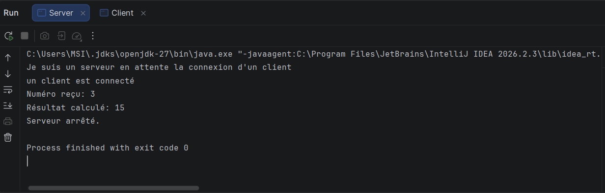

### Interprétation

Avant l'ajout de la boucle, le serveur reçoit un seul entier, effectue une seule multiplication et renvoie un seul résultat au client.

Après l'envoi du résultat, le serveur ferme la connexion et s'arrête.

### Capture d'écran du client avant la boucle

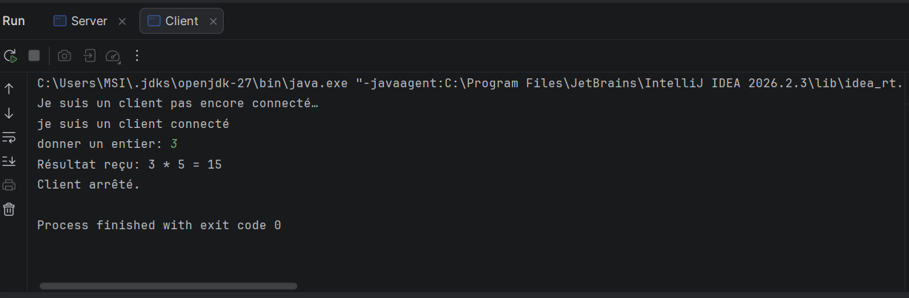

### Interprétation

Avant l'ajout de la boucle, le client saisit et envoie un seul entier au serveur.

Il reçoit ensuite le résultat de la multiplication par `5`, l'affiche dans sa console, puis ferme la connexion.

---

## Étape 3 : Ajout de la boucle

Une boucle `do...while` a été ajoutée dans le client et dans le serveur.

Cette boucle permet au client de saisir et d'envoyer plusieurs entiers successivement sans créer une nouvelle connexion pour chaque calcul.

La communication continue tant que la valeur saisie est différente de `0`.

### Fonctionnement côté client

À chaque itération, le client réalise les opérations suivantes :

1. Il demande à l'utilisateur de saisir un entier.
2. Il envoie l'entier au serveur avec `writeInt()`.
3. Il attend le résultat envoyé par le serveur.
4. Il reçoit le résultat avec `readInt()`.
5. Il affiche le résultat.
6. Il recommence tant que l'entier saisi est différent de `0`.

### Fonctionnement côté serveur

À chaque itération, le serveur réalise les opérations suivantes :

1. Il reçoit l'entier envoyé par le client.
2. Il calcule le produit de cet entier par `5`.
3. Il affiche la valeur reçue et le résultat calculé.
4. Il envoie le résultat au client.
5. Il recommence tant que l'entier reçu est différent de `0`.

---

## Étape 4 : Test après l'ajout de la boucle

Le programme a été testé avec plusieurs valeurs positives, négatives et nulles.

### Exemples de tests

- Pour `x = 5`, le résultat attendu est `25`.
- Pour `x = -4`, le résultat attendu est `-20`.
- Pour `x = 99`, le résultat attendu est `495`.
- Pour `x = 0`, le résultat est `0` et la communication s'arrête.

### Capture d'écran du serveur après la boucle

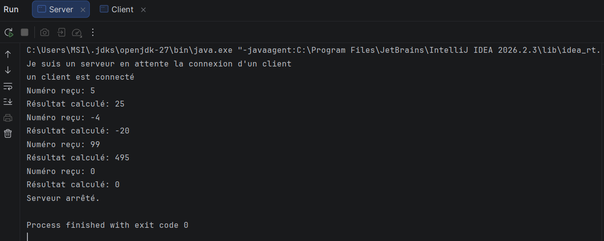

### Interprétation

Après l'ajout de la boucle, le serveur peut recevoir plusieurs entiers dans une même connexion TCP.

Pour chaque entier reçu, il calcule le résultat de la multiplication par `5` et l'envoie au client.

Lorsque le serveur reçoit la valeur `0`, la condition `x != 0` devient fausse. Le serveur quitte alors la boucle, ferme les flux, ferme les sockets et affiche le message indiquant son arrêt.

### Capture d'écran du client après la boucle

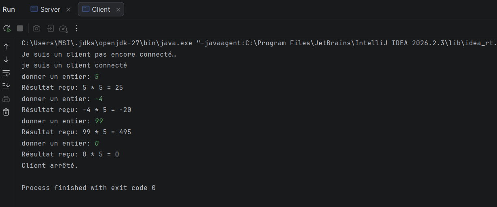

### Interprétation

Après l'ajout de la boucle, le client peut saisir plusieurs entiers successivement.

Pour chaque valeur saisie, il envoie l'entier au serveur et affiche le résultat reçu.

Lorsque l'utilisateur saisit `0`, le client reçoit le résultat `0`, quitte la boucle, ferme les flux et la socket, puis affiche le message indiquant son arrêt.

---

## Communication entre le client et le serveur

- Adresse IP du serveur : `192.168.1.5`
- Port utilisé : `1234`
- Type de connexion : TCP
- Opération réalisée : `x × 5`
- Valeur utilisée pour terminer la communication : `0`

---

## Résultat de l'activité 1-2

Le service de calculatrice a été développé avec succès.

Le client peut envoyer plusieurs entiers au serveur dans une même connexion TCP. Le serveur reçoit chaque entier, calcule son produit par `5` et renvoie le résultat au client.

L'utilisation des classes `DataInputStream` et `DataOutputStream` permet d'envoyer et de recevoir correctement les valeurs entières, y compris les valeurs négatives.

La boucle `do...while` permet de répéter la communication jusqu'à la saisie de la valeur `0`. Après cette valeur, le client et le serveur ferment correctement leurs flux et leurs sockets.

---

# Activité 1-3 : Service de calculatrice avec choix de l'opérateur

## Objectif

L'objectif de cette activité est d'améliorer le service de calculatrice développé précédemment.

Le client choisit un opérateur parmi les opérateurs suivants :

- `+` pour effectuer une addition.
- `-` pour effectuer une soustraction.
- `*` pour effectuer une multiplication.
- `/` pour effectuer une division.

Après le choix de l'opérateur, le client saisit un entier `x`.

Le client envoie l'opérateur et l'entier au serveur. Le serveur reçoit les deux informations, effectue l'opération entre `x` et `5`, puis renvoie le résultat au client.

---

## Étape 1 : Vérification de l'adresse IP du serveur

La commande `ipconfig` a été utilisée sur la machine serveur afin d'identifier son adresse IPv4.

Cette adresse IP permet au client d'identifier la machine sur laquelle le serveur est exécuté.

### Capture d'écran de l'adresse IP du serveur

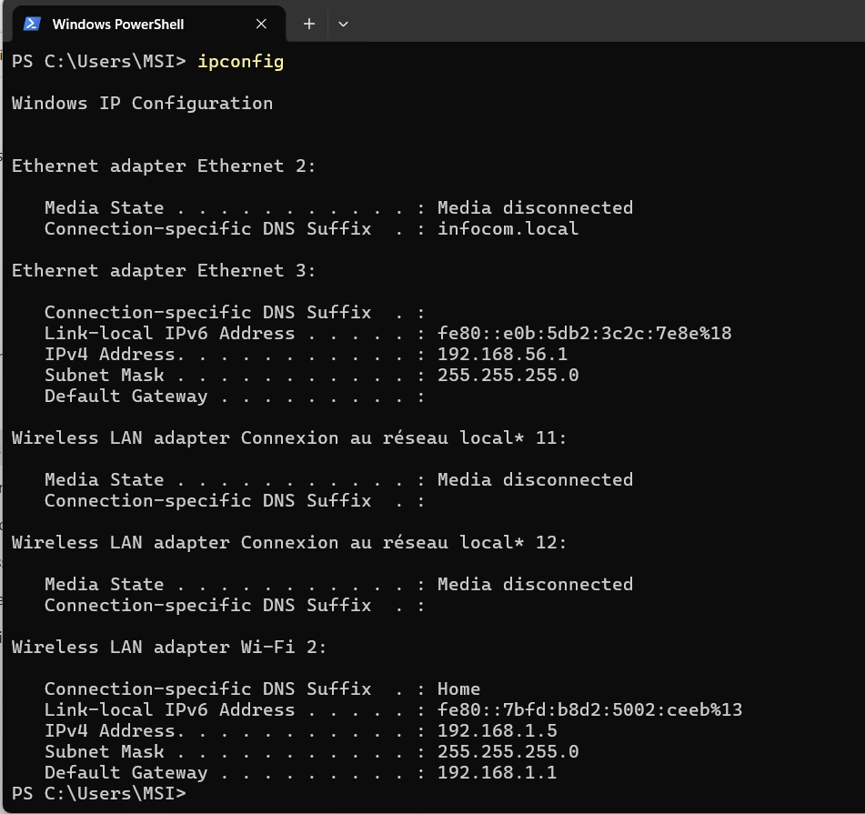

### Interprétation

La commande `ipconfig` affiche les informations de configuration réseau de la machine serveur.

L'adresse IPv4 récupérée peut être utilisée dans le programme client lorsque le client et le serveur sont exécutés sur deux machines différentes connectées au même réseau local.

Pour les tests effectués sur une seule machine, l'adresse locale `127.0.0.1` a été utilisée.

---

## Étape 2 : Test de communication avec la commande ping

La commande `ping` a été utilisée afin de vérifier que la machine cliente peut communiquer avec la machine serveur à travers le réseau.

### Capture d'écran du test ping

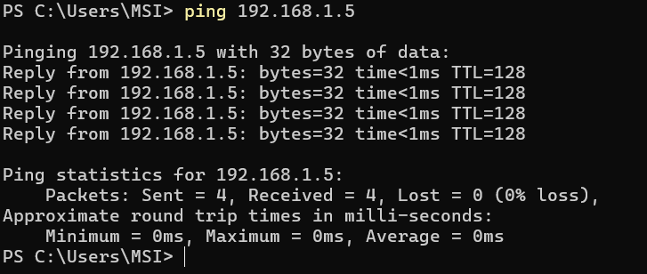

### Interprétation

La réception de réponses à la commande `ping` confirme que la machine serveur est accessible depuis la machine cliente.

Cette vérification doit être effectuée avant de lancer le client lorsque les deux programmes sont exécutés sur deux machines distinctes.

---

## Étape 3 : Création de l'adresse du serveur côté client

Le client utilise la classe `InetSocketAddress` afin d'associer l'adresse IP du serveur au port `1234`.

L'adresse du serveur est créée à partir des deux informations suivantes :

- Adresse IP utilisée pour le test local : `127.0.0.1`.
- Port utilisé : `1234`.

Le client crée ensuite une socket et utilise la méthode `connect()` afin d'établir la connexion avec le serveur.

Un délai maximal de connexion de `5000` millisecondes a été défini.

---

## Étape 4 : Attente de la connexion

Le serveur démarre sur le port `1234` et attend l'arrivée d'un client avec la méthode `accept()`.

Le client prépare l'adresse du serveur puis demande l'établissement de la connexion TCP.

### Capture d'écran du serveur en attente

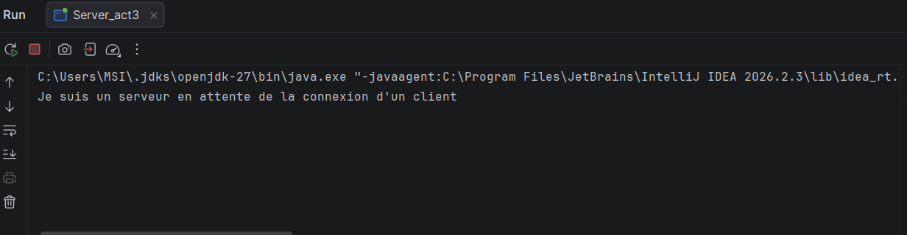

### Interprétation

Avant le lancement du client, le serveur affiche un message indiquant qu'il attend une connexion.

La méthode `accept()` bloque temporairement l'exécution du serveur jusqu'à ce qu'un client demande une connexion sur le port `1234`.

### Capture d'écran du client pendant la connexion

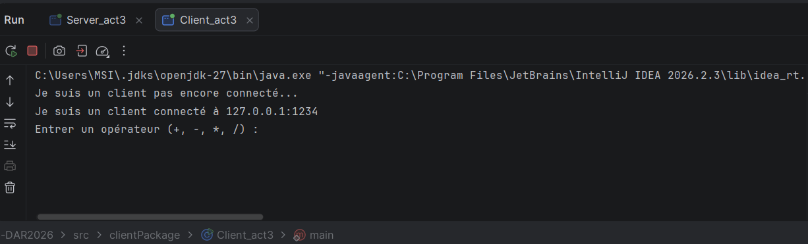

### Interprétation

Le client commence par afficher un message indiquant qu'il n'est pas encore connecté.

Il utilise ensuite l'adresse du serveur et le port `1234` pour établir la connexion TCP. Après la réussite de la connexion, un message de confirmation est affiché.

---

## Étape 5 : Saisie et vérification de l'opérateur

Le client demande à l'utilisateur de saisir un opérateur.

Les opérateurs acceptés sont :

- `+`
- `-`
- `*`
- `/`

Une boucle `while` est utilisée pour contrôler la valeur saisie.

Si l'utilisateur saisit un caractère différent de ces quatre opérateurs, le client affiche un message d'erreur et demande une nouvelle saisie.

Le client ne transmet donc au serveur qu'un opérateur valide.

---

## Étape 6 : Envoi de l'opérateur et de l'entier

Après la validation de l'opérateur, le client demande à l'utilisateur de saisir un entier.

Le client envoie les informations au serveur dans l'ordre suivant :

1. L'opérateur est envoyé avec la méthode `writeChar()`.
2. L'entier est envoyé avec la méthode `writeInt()`.
3. La méthode `flush()` force l'envoi des données.

Le serveur doit recevoir les informations dans le même ordre :

1. L'opérateur est reçu avec la méthode `readChar()`.
2. L'entier est reçu avec la méthode `readInt()`.

Le respect de cet ordre est nécessaire pour garantir la bonne communication entre le client et le serveur.

---

## Étape 7 : Traitement côté serveur

Après la réception de l'opérateur et de l'entier, le serveur appelle une méthode de calcul.

Le calcul effectué dépend de l'opérateur reçu :

- Avec l'opérateur `+`, le serveur calcule `x + 5`.
- Avec l'opérateur `-`, le serveur calcule `x - 5`.
- Avec l'opérateur `*`, le serveur calcule `x × 5`.
- Avec l'opérateur `/`, le serveur calcule `x / 5`.

Le serveur envoie ensuite le résultat au client avec la méthode `writeInt()`.

Le client reçoit le résultat avec la méthode `readInt()` puis l'affiche dans sa console.

---

## Étape 8 : Test de validation de l'opérateur

Le client a été testé avec plusieurs caractères.

Les valeurs suivantes ont d'abord été saisies :

- L'opérateur invalide `m`.
- La valeur invalide `5`.

Pour chacune de ces valeurs, le client a affiché le message suivant :

`Opérateur invalide. Veuillez réessayer.`

L'opérateur valide `/` a ensuite été saisi.

Le client a accepté cet opérateur et a demandé la saisie d'un entier.

---

## Étape 9 : Test de la division avec la valeur zéro

Le test suivant a été réalisé :

- Opérateur choisi : `/`
- Entier saisi : `0`
- Opération effectuée par le serveur : `0 / 5`
- Résultat retourné : `0`

### Capture d'écran du test côté client

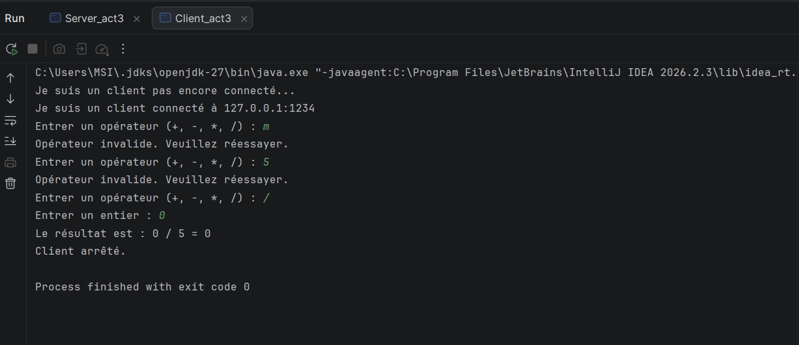

### Interprétation

La capture montre que le client refuse les caractères `m` et `5`, car ces valeurs ne correspondent pas à un opérateur valide.

Après chaque saisie incorrecte, le client demande à nouveau un opérateur.

Lorsque l'opérateur `/` est saisi, le client l'accepte et demande un entier. La valeur `0` est ensuite envoyée au serveur.

Le serveur effectue le calcul `0 / 5` et renvoie le résultat `0`.

Le client affiche le résultat reçu puis ferme ses flux et sa socket. Le message `Client arrêté` et le code de sortie `0` indiquent que le programme s'est terminé normalement.

---

## Classes et méthodes utilisées

Les principales classes utilisées dans cette activité sont :

- `Socket` pour créer la socket cliente.
- `ServerSocket` pour créer la socket serveur.
- `InetSocketAddress` pour associer l'adresse IP du serveur au port.
- `Scanner` pour saisir l'opérateur et l'entier.
- `InputStream` pour accéder au flux d'entrée.
- `OutputStream` pour accéder au flux de sortie.
- `DataInputStream` pour recevoir l'opérateur, l'entier ou le résultat.
- `DataOutputStream` pour envoyer l'opérateur, l'entier ou le résultat.

Les principales méthodes utilisées sont :

- `connect()` pour connecter le client au serveur.
- `accept()` pour attendre la connexion d'un client.
- `writeChar()` pour envoyer l'opérateur.
- `readChar()` pour recevoir l'opérateur.
- `writeInt()` pour envoyer un entier.
- `readInt()` pour recevoir un entier.
- `flush()` pour forcer l'envoi des données.
- `close()` pour fermer les flux et les sockets.

---

## Communication entre le client et le serveur

- Adresse utilisée pendant le test local : `127.0.0.1`
- Port utilisé : `1234`
- Protocole utilisé : TCP
- Délai maximal de connexion : `5000` millisecondes
- Type de l'opérateur : `char`
- Type de l'entier : `int`
- Type du résultat : `int`

---

## Remarque sur l'adresse IP

L'adresse `127.0.0.1` représente la machine locale.

Cette adresse est utilisée lorsque le client et le serveur sont exécutés sur le même ordinateur.

Lorsque le client et le serveur sont exécutés sur deux machines différentes, la constante `IP_SERVEUR` du client doit contenir l'adresse IPv4 réelle de la machine serveur.

Les deux machines doivent également être connectées au même réseau local.

---

## Remarque sur la division

Le programme utilise le type `int` pour l'entier et pour le résultat.

La division est donc une division entière.

Par exemple :

- `20 / 5` donne `4`.
- `12 / 5` donne `2`.
- `0 / 5` donne `0`.

Les chiffres situés après la virgule ne sont pas conservés avec le type `int`.

---

## Résultat de l'activité 1-3

Le service de calculatrice avec choix de l'opérateur a été développé avec succès.

Le client vérifie que l'opérateur saisi appartient à la liste `+`, `-`, `*` ou `/`. Les opérateurs incorrects sont refusés avant l'envoi des données au serveur.

Le client envoie ensuite l'opérateur et l'entier au serveur. Le serveur effectue le calcul demandé avec la valeur `5`, puis renvoie le résultat au client.

Le test réalisé avec l'opérateur `/` et l'entier `0` a retourné correctement le résultat `0`.

Les flux d'entrée, les flux de sortie et les sockets sont fermés après la réception et l'affichage du résultat.